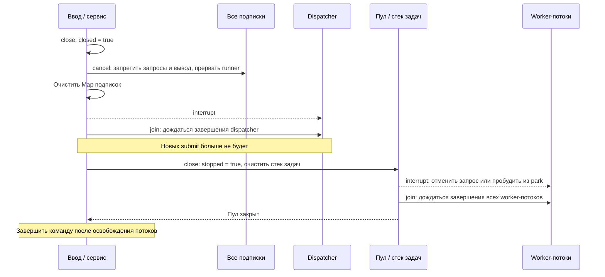

# Семинар 10: порядок показа кода

Время — от начала занятия. Основной маршрут — **90 минут**, дополнительный блок — **30 минут**.
Код готовый: открывать указанные методы, обсуждать их и запускать демонстрации.
Колонка «Тема презентации» указывает, после какого теоретического блока переходить в IDE;
«Акцент» — конкретное место в коде и вывод для обсуждения.

## До начала

- Импортировать корневой `pom.xml`, выбрать JDK 25, поднять моковый сервер.
- Собрать jcstress и заранее подготовить отчёт: [инструкция и результаты](Эксперименты%20JMM.md).
- Команды запуска приложения и демонстраций: [COMMANDS.md](../../COMMANDS.md).

## Основной маршрут

| Время | Тема презентации | Где смотреть | Акцент в коде и вывод |
|-------|------------------|--------------|-----------------------|
| **0–5 мин** | Сквозной пример: временные подписки | `subscriptions`: `watch SBER 3s 30s`; [SubscriptionsCommand](../../../src/main/java/academy/backend/market_pulse/cli/SubscriptionsCommand.java): `call`, `watch`. | Показать разделение ролей: основной поток принимает команды, dispatcher считает сроки, worker выполняет запрос. В `watch` параметры уже представлены проверенным `SubscriptionRequest`. |
| **5–17 мин** | Платформенные потоки: состояния Java и операционной системы | Запустить [ThreadStatesDemo](../../../src/main/java/academy/backend/market_pulse/demo/concurrency/ThreadStatesDemo.java); `jcmd <pid> Thread.print`, затем Enter. | Сопоставить `park` с `WAITING`, `sleep` с `TIMED_WAITING`, вход в занятый монитор с `BLOCKED`. `RUNNABLE` не доказывает загрузку процессора; `getState` — наблюдение, а не синхронизация. |
| **17–25 мин** | Thread API: `run`, `start`, `join`; роли потоков | [ThreadApiDemo](../../../src/main/java/academy/backend/market_pulse/demo/concurrency/ThreadApiDemo.java): `demonstrateRunAndStart`, `demonstrateBuilderAndJoin`; конструкторы [TreiberThreadPool](../../../src/main/java/academy/backend/market_pulse/concurrent/TreiberThreadPool.java) и [QuoteSubscriptionService](../../../src/main/java/academy/backend/market_pulse/concurrent/QuoteSubscriptionService.java). | `run` выполняется в текущем потоке, `start` создаёт отдельное выполнение. После `join` виден результат обычного поля. Показать `.start(this::work)` и `.start(this::dispatch)`: пул живёт дольше одного запроса. |
| **25–40 мин** | Ошибки фоновых потоков и кооперативная отмена | [UncaughtExceptionDemo](../../../src/main/java/academy/backend/market_pulse/demo/concurrency/UncaughtExceptionDemo.java), [InterruptDemo](../../../src/main/java/academy/backend/market_pulse/demo/concurrency/InterruptDemo.java); [HttpInterruptExperiment](../../../src/main/java/academy/backend/market_pulse/demo/concurrency/HttpInterruptExperiment.java): `receiveWithHttpClient`, `receiveWithUrlConnection`, `verifyCancellation`. | В `sleep` исключение сбрасывает флаг; в `park` флаг сохраняется. У `HttpClient.send` есть прерываемое ожидание, у чтения `HttpURLConnection` такой гарантии нет. `join` не перебрасывает исключение worker в основной поток. |
| **40–50 мин** | Ожидание: монитор, `wait` / `sleep`, `park` / `unpark` | Кратко [WaitingDemo](../../../src/main/java/academy/backend/market_pulse/demo/concurrency/WaitingDemo.java), затем [ParkingDemo](../../../src/main/java/academy/backend/market_pulse/demo/concurrency/ParkingDemo.java); пул: `awaitTask`, `submit`; сервис: `dispatch`; [Subscription](../../../src/main/java/academy/backend/market_pulse/concurrent/Subscription.java): `scheduleIfDue`, `finishRequest`. | `sleep` не освобождает монитор, `wait` освобождает. `unpark` сохраняет один permit; после `park` нужно заново проверить условие. `requestScheduled = true` ставится **до** `submit`, а `nextRun` рассчитывается **после** завершения запроса. |
| **50–65 мин** | Java Memory Model: happens-before и `volatile` | [DekkerPlain](../../../../jcstress/src/main/java/academy/backend/market_pulse/jmm/DekkerPlain.java) → [DekkerVolatile](../../../../jcstress/src/main/java/academy/backend/market_pulse/jmm/DekkerVolatile.java); [PublicationPlain](../../../../jcstress/src/main/java/academy/backend/market_pulse/jmm/PublicationPlain.java) → [PublicationVolatile](../../../../jcstress/src/main/java/academy/backend/market_pulse/jmm/PublicationVolatile.java); подготовленный отчёт. При необходимости — [ResultProvider](../../../src/main/java/academy/backend/market_pulse/demo/concurrency/ResultProvider.java): `complete`, `await`. | До отчёта спросить про `(0,0)` и флаг без данных. В публикации проследить цепочку: запись `data` → volatile-запись `ready` → чтение `ready == true` → чтение `data`. Показать `@Actor` и `@Outcome`; отсутствие редкого исхода не доказывает корректность. |
| **65–80 мин** | Атомарность составной операции: compare-and-set | [TreiberPushPlain](../../../../jcstress/src/main/java/academy/backend/market_pulse/jmm/TreiberPushPlain.java) → [TreiberPushCas](../../../../jcstress/src/main/java/academy/backend/market_pulse/jmm/TreiberPushCas.java); [TreiberStack](../../../src/main/java/academy/backend/market_pulse/concurrent/TreiberStack.java): `push`, `pop`; пул: `submit`, `close`. | В цикле два потока могут прочитать один `head`: простая запись потеряет Node. `compareAndSet` проверяет **ту же ссылку** и заменяет её атомарно; при конфликте нужен повтор с новым `head`. Жизненный цикл относится к пулу, стек отвечает за задачи. |
| **80–90 мин** | Применение: отмена и завершение потоков | Снова `subscriptions`; сервис: `remove`, `refresh`, `close`; [Subscription](../../../src/main/java/academy/backend/market_pulse/concurrent/Subscription.java): `beginRequest`, `cancel`, `publish`; [SubscriptionResultHandler](../../../src/main/java/academy/backend/market_pulse/concurrent/SubscriptionResultHandler.java). | `beginRequest` повторно проверяет срок **после ожидания в стеке**. В `cancel` монитор согласует выбор `runner` и его `interrupt`, а `resultLock` — callback с отменой. В `close` сначала `join` dispatcher, затем `pool.close()`: producer уже остановлен. |

## Дополнительные 30 минут

Вставить **после стека и перед итоговой демонстрацией**: этот блок займёт 80–110 минут,
а заключительный этап основного маршрута сдвинется на 110–120 минут.

| Время | Тема презентации | Где смотреть | Акцент в коде и вывод |
|-------|------------------|--------------|-----------------------|
| **80–90 мин** | `volatile`: видимость не равна атомарности | [IncrementPlain](../../../../jcstress/src/main/java/academy/backend/market_pulse/jmm/IncrementPlain.java) → [IncrementVolatile](../../../../jcstress/src/main/java/academy/backend/market_pulse/jmm/IncrementVolatile.java); результаты прогонов. | В обоих классах `counter++` состоит из чтения, увеличения и записи. `@Arbiter` читает итог после двух `@Actor`; результат `1` показывает потерю одного инкремента даже с `volatile`. |
| **90–100 мин** | Гарантии `final` и корректное конструирование | [FinalPublication](../../../../jcstress/src/main/java/academy/backend/market_pulse/jmm/FinalPublication.java): `writer`, `reader`; [FinalValueHolder](../../../../jcstress/src/main/java/academy/backend/market_pulse/jmm/FinalValueHolder.java). | `holder` — обычная ссылка, `value` — final-поле. Конструктор не публикует `this`: читатель может не увидеть ссылку, но у увиденного объекта поле не должно быть равно нулю. |
| **100–110 мин** | Монитор: границы составной операции | [AccountRaceDemo](../../../src/main/java/academy/backend/market_pulse/demo/concurrency/AccountRaceDemo.java): `demonstrateStaleCheck`; [WithdrawalAccount](../../../src/main/java/academy/backend/market_pulse/demo/concurrency/WithdrawalAccount.java): `hasEnough`, `withdrawWithoutCheck`, `withdraw`. | Сначала оба потока проверяют баланс, затем списывают. Монитор только вокруг списания не исправляет старую проверку; сравнить с проверкой и изменением под одним монитором в `withdraw`. |

## Взаимодействие компонентов по командам

`watch`, `remove` и `close` вызываются последовательно из потока CLI. Учебный сервис
не поддерживает параллельные вызовы этих команд.

Время на диаграммах идёт сверху вниз. Ввод, dispatcher и worker — разные потоки.
Сервис, состояние `Subscription`, пул и стек — объекты; собственных потоков у этих объектов нет,
они создают или обслуживают показанные потоки. Стрелка `unpark` — сигнал продолжить проверку,
а не передача задачи конкретному worker.

### `watch SBER 3s 30s`: регистрация и обновления

```mermaid
sequenceDiagram
    participant C as Ввод / сервис
    participant D as Dispatcher
    participant P as Пул / стек задач
    participant W as Worker
    participant H as HTTP-клиент / сервер
    C->>C: Проверить DTO, watch: создать Subscription
    C-->>D: unpark
    Note over C: Сразу вернуться к чтению команд
    D->>D: scheduleIfDue: зарезервировать запрос
    D->>P: submit → push задачи в стек
    P-->>W: unpark worker-потоков
    W->>P: pop: получить задачу
    W->>W: beginRequest: проверить отмену и срок
    W->>H: fetchQuotes: ждать ответ
    H-->>W: Каталог с котировками
    W->>W: Выбрать SBER, publish: вывести цену
    W->>W: finishRequest: следующий запуск через 3 с
    W-->>D: unpark: пересчитать ожидание
    Note over D,W: Dispatcher ждёт срока; worker свободен для других тикеров
```

Один тикер имеет не больше одного поставленного или выполняющегося запроса. Цикл повторяется,
пока не истекли 30 секунд. Истечение срока запрещает новые запросы; уже начатый может завершиться.
Задача, срок которой истёк в стеке, пропускается при `beginRequest`.

### `remove SBER`: отмена одной подписки

```mermaid
sequenceDiagram
    participant C as Ввод / сервис
    participant S as Subscription SBER
    participant W as Worker запроса
    participant D as Dispatcher
    C->>C: Удалить SBER из Map подписок
    C->>S: cancel: установить cancelled
    alt Запрос уже выполняется
        S-->>W: interrupt текущего runner
        Note right of W: Асинхронно: send завершится прерыванием;<br/>finishRequest освободит worker без вывода ошибки
    else Задача ещё в стеке
        Note over S,W: При извлечении beginRequest вернёт false; HTTP не начнётся
    end
    S-->>C: Дождаться уже начатого вывода
    C-->>D: unpark
    Note over C,D: После возврата remove новых сообщений SBER нет; другие тикеры продолжают работать
```

Прерывание согласовано с освобождением `runner`: worker не успеет перейти к чужой задаче
между выбором потока и `interrupt`. `remove` не ждёт завершения самого запроса, только согласует отмену и вывод.
Сценарий прерывания HTTP показан для `HTTP_CLIENT`.
Если подписки нет, `remove` сразу возвращает `false`.

### `exit` или конец ввода: остановка всей сессии



`exit` отменяет все подписки, `remove` — только выбранную. Если ожидающий завершения основной
поток прервали, `close` сначала дожидается остановки, затем восстанавливает флаг прерывания
и сообщает о нём вызывающему коду.

## Финальная демонстрация

В запущенной сессии `subscriptions` вводить по одной строке, дожидаясь обновлений:

```text
watch SBER 1s 10s
watch GAZP 2s 10s
remove SBER
exit
```

Для медленного ответа использовать `MARKET_PULSE_CLIENT=HTTP_CLIENT` и
`MARKET_PULSE_MOCK_SCENARIO=timeout`: удалить подписку во время запроса, затем завершить сессию.
Если время ограничено, смотреть готовые результаты jcstress, без живого стресс-прогона.
