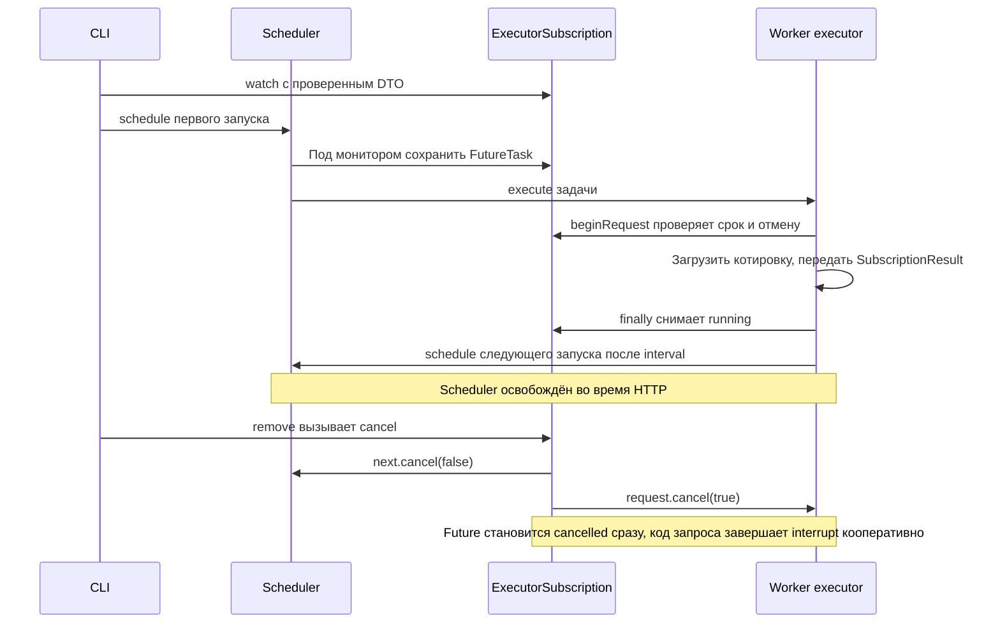

# Семинар 11 — порядок показа кода

Маршрут рассчитан на **120 минут**. Сначала вопросы по семинару 10, затем самостоятельные
примеры синхронизаторов, коллекций, Executor Framework и ForkJoinPool. Рефакторинг подписок
задан для самостоятельной работы после занятия.

## До начала

- Выбрать JDK 25 и импортировать корневой `pom.xml`.
- Открыть готовые демонстрации в тестовом пакете `demo.concurrency`.
- Подготовить [таблицы результатов JMH](JMH%20—%20результаты.md).
- Для финального примера поднять mock-server и выбрать `MARKET_PULSE_CLIENT=HTTP_CLIENT`.
- Команды запуска приведены в [COMMANDS.md](../../COMMANDS.md).

## Маршрут

| Время | Тема презентации | Где смотреть | На что обратить внимание |
|-------|------------------|--------------|--------------------------|
| **0–10 мин** | Вопросы по потокам, interrupt и JMM | По вопросам группы вернуться к `ThreadApiDemo`, `InterruptDemo`, `PublicationVolatile` семинара 10. | Разобрать конкретный переход состояния или цепочку публикации. Уточнить разницу между отменой запроса и остановкой worker. |
| **10–15 мин** | Атомики и compare-and-set | [TreiberStack](../../../src/main/java/academy/backend/market_pulse/concurrent/TreiberStack.java), `push`, `pop`. | `compareAndSet` сравнивает прежнюю ссылку и заменяет её атомарно. При конфликте повторяется чтение head и создание Node. |
| **15–35 мин** | CountDownLatch, Semaphore, ReentrantLock и Condition | [SynchronizersDemoTest](../../../src/test/java/academy/backend/market_pulse/demo/concurrency/SynchronizersDemoTest.java), `awaitAllQuotes`, `limitConcurrentRequests`, `awaitPriceCondition`. | В latch событие завершения отмечается в finally. В semaphore `release` соответствует успешному `acquire`. У condition обе стороны держат один lock, `await` стоит в while. Перед запуском спросить, какое событие разблокирует ожидание. |
| **35–50 мин** | Concurrent collections и ожидание в очереди | [ConcurrentCollectionsDemoTest](../../../src/test/java/academy/backend/market_pulse/demo/concurrency/ConcurrentCollectionsDemoTest.java), `atomicPerTickerCounter`, `boundedTaskQueue`, по времени `snapshotIterator`. Затем [результаты JMH](JMH%20—%20результаты.md). | `merge` делает обновление одного ключа атомарным. У bounded queue `put` ждёт место, `take` ждёт элемент. Snapshot-итератор показывает снимок списка. В JMH сравнить один и восемь потоков, чтение и mixed-нагрузку. |
| **50–65 мин** | Упражнения по синхронизации и коллекциям | [SynchronizationExercises](../../../src/test/java/academy/backend/market_pulse/demo/concurrency/SynchronizationExercises.java), три проверки. Редактировать [RequestCounter](../../../src/test/java/academy/backend/market_pulse/demo/concurrency/RequestCounter.java), `record`, и `SynchronizationExercises.awaitItem`. | Задать прогноз результата. В `record` исправить потерянные обновления одного ключа, в `awaitItem` обеспечить прерываемое ожидание. 2 минуты на условие, 9 на решение, 4 на запуск и обсуждение. |
| **65–95 мин** | Executor Framework, Future, timeout, отмена и завершение | [ExecutorFrameworkDemoTest](../../../src/test/java/academy/backend/market_pulse/demo/concurrency/ExecutorFrameworkDemoTest.java), `resultAndFailure`, `timeoutThenCancel`, `boundedPoolRejectsOverload`, `periodicFailureStopsRepetition`, `shutdownLetsQueuedTaskFinish`, `shutdownNowInterruptsRunningTask`. | Future хранит результат или причину сбоя. Timeout у `get` завершает ожидание вызывающего потока. В `ThreadPoolExecutor` проследить core → очередь → max → rejection. Сравнить завершение queued-задачи после shutdown с interrupt при shutdownNow. Исключение периодической задачи прекращает повторения. |
| **95–107 мин** | Упражнения по Executor Framework | [ExecutorExercises](../../../src/test/java/academy/backend/market_pulse/demo/concurrency/ExecutorExercises.java), методы `start`, `stop`, проверки результата и отмены. | Передать Callable в executor, вернуть Future, запросить прерывание выполняющейся задачи. 2 минуты на условие, 7 на решение, 3 на запуск и обсуждение. |
| **107–117 мин** | ForkJoinPool, work stealing, fork/compute/join | [ForkJoinKitchenDemoTest](../../../src/test/java/academy/backend/market_pulse/demo/concurrency/ForkJoinKitchenDemoTest.java) и [PortionsTask](../../../src/test/java/academy/backend/market_pulse/demo/concurrency/PortionsTask.java), `compute`. Затем [ForkJoinArrayDemoTest](../../../src/test/java/academy/backend/market_pulse/demo/concurrency/ForkJoinArrayDemoTest.java), [SignCountTask](../../../src/test/java/academy/backend/market_pulse/demo/concurrency/SignCountTask.java). | У каждой задачи свой диапазон и локальный результат. `fork` публикует одну ветвь для work stealing, текущий worker считает другую через `compute`, `join` объединяет результат. По времени открыть [QuoteBreadthTask](../../../src/main/java/academy/backend/market_pulse/concurrent/QuoteBreadthTask.java), `compute`, `countSequentially`. |
| **117–120 мин** | Самостоятельный рефакторинг приложения | [QuoteSubscriptions](../../../src/main/java/academy/backend/market_pulse/concurrent/QuoteSubscriptions.java), `create`, и [практика](Практика.md). | Показать три engine. Задать замену передачи задач на BlockingQueue, затем на стандартные executor. Сохранить DTO, обработку результатов, отмену и отсутствие перекрытия HTTP одного тикера. |

## Упражнения и запуск

Демонстрации с суффиксом `Test` проходят в обычном `mvn test`. Два класса `*Exercises`
запускаются явно. Они содержат TODO и исходно не проходят свои проверки.

```bash
mvn -pl advanced -Dtest=SynchronizationExercises test
mvn -pl advanced -Dtest=ExecutorExercises test
```

## Что открыть при обсуждении практики

| Переход | Классы и методы | Акцент |
|---------|-----------------|--------|
| `treiber` → `queue` | [TreiberThreadPool](../../../src/main/java/academy/backend/market_pulse/concurrent/TreiberThreadPool.java), `submit`, `awaitTask`; [QueueThreadPool](../../../src/main/java/academy/backend/market_pulse/concurrent/QueueThreadPool.java), `submit`, `work`. | Вместо push/pop и park/unpark используются add/take. FIFO задаёт порядок извлечения ожидающих задач. |
| Общий сценарий | [QuoteSubscriptionService](../../../src/main/java/academy/backend/market_pulse/concurrent/QuoteSubscriptionService.java), `dispatchDueRequests`, `submitIfDue`; [TaskPool](../../../src/main/java/academy/backend/market_pulse/concurrent/TaskPool.java). | Dispatcher, DTO и фазы исходной подписки сохраняются при замене собственного пула. |
| `queue` → `executor` | [ExecutorQuoteSubscriptionService](../../../src/main/java/academy/backend/market_pulse/concurrent/ExecutorQuoteSubscriptionService.java), `schedule`, `dispatch`, `refresh`; [ExecutorSubscription](../../../src/main/java/academy/backend/market_pulse/concurrent/ExecutorSubscription.java), `cancel`. | Scheduler рассчитывает срок, worker выполняет HTTP. Future публикуется до execute, cancel(true) действует на конкретную задачу. Следующий запуск назначается в finally после завершения запроса. |
| Отмена и срок | `ExecutorSubscription.beginRequest`, `isExpiredAndNotRunning`, `cancel`, `publish`. | Queued-задача проверяет срок перед HTTP. `running` отражает выполнение кода, статус Future может стать cancelled раньше. `resultLock` согласует callback с возвратом remove. |
| Результат и ошибка callback | `ExecutorQuoteSubscriptionService.loadResult`, `reportTaskFailure`; `SubscriptionsCommand.formatResult`. | Цена и ошибка загрузки передаются как SubscriptionResult. Сбой callback идёт в отдельный onTaskFailure. |
| Завершение | `QuoteSubscriptionService.close`, `ExecutorQuoteSubscriptionService.close`. | Сначала прекращается назначение новых задач, затем завершаются worker-потоки. Close возвращается после освобождения потоков. |

## Схема стандартного executor



## Финальная демонстрация

Запустить приложение с аргументами `subscriptions --engine treiber --workers 2`, затем сравнить
`queue` и `executor`. В каждой сессии вводить по одной строке, дожидаясь обновлений.

```text
watch SBER 1s 10s
watch GAZP 2s 10s
remove SBER
exit
```

Для медленного ответа задать `MARKET_PULSE_MOCK_SCENARIO=timeout` и отменить запрос через remove.
Подробные команды запуска находятся в [COMMANDS.md](../../COMMANDS.md).
